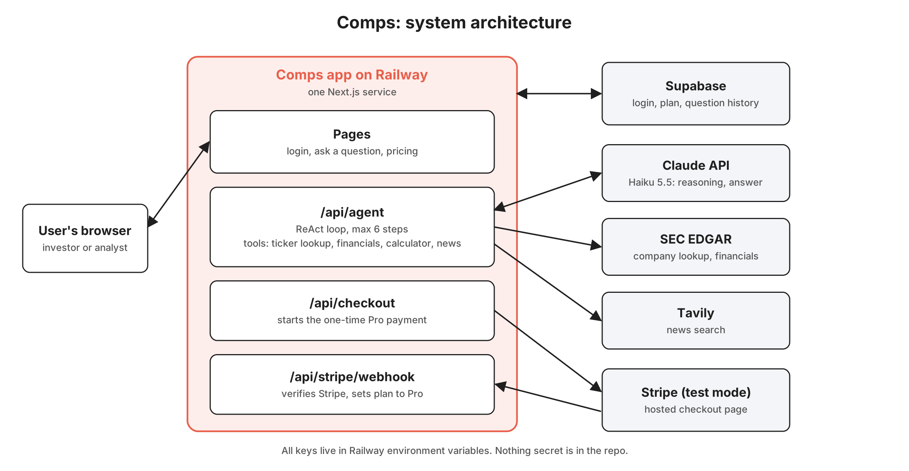

# Architecture

Comps is a single Next.js app deployed as one service on Railway. The frontend, API routes, and the agent all run in the same service. Supabase handles login and stores each user's plan and question history. Stripe handles the one-time Pro upgrade in test mode.

## System diagram



## How the agent works


## How a question flows through the system

1. The user submits a question. `/api/agent` checks the Supabase session, then checks usage: a free user must have fewer than 3 successful questions, and a Pro user fewer than 25 today. If not, it returns an upgrade or daily-limit message.
2. The agent loop starts. Each turn, the LLM either picks a tool (Thought, then Action) or writes the final answer.
3. The tool runs and its result goes back to the LLM as the Observation. Each step is streamed to the browser as newline-delimited JSON so the user sees the trace live.
4. The loop stops when the LLM gives a final answer or hits the cap of 6 iterations (8 for why/driver questions).
5. The run (question, answer, trace, status) is saved to the `runs` table. Only successful runs count toward usage, so a failed question never uses up one of the user's questions.

## How the Pro upgrade flows through the system

1. A free user clicks Upgrade. `/api/checkout` creates a one-time Stripe Checkout session with the user's id in the metadata.
2. The user pays with a test card on Stripe's hosted page and is sent back to the app.
3. Stripe calls `/api/stripe/webhook`. The webhook verifies Stripe's signature, then sets that user's plan to `pro`.
4. Setting the plan to `pro` is safe to repeat, so if Stripe sends the same event twice, nothing breaks.

## Data model (Supabase)

| Table | Columns | Notes |
|---|---|---|
| `profiles` | `id` (= auth user id), `email`, `plan` (`free` or `pro`, default `free`), `pro_since`, `created_at` | Created automatically on signup |
| `runs` | `id`, `user_id`, `thread_id` (nullable FK to `threads`, no cascade), `question`, `answer`, `trace` (json), `status` (`success` or `failed`), `created_at` | One row per question. Usage limits are counted from this table (never from threads) |
| `threads` | `id`, `user_id` (FK `auth.users`), `title` (first question, max 120 chars), `created_at`, `updated_at` | One row per research conversation (migration `002_add_threads.sql`). History lists threads by `updated_at` |

Row-level security is on for all three tables, so a user can only read their own rows. `threads` also has own-row insert/update policies (the app itself writes with the service key).

**Threads flow** (`/api/agent`, optional `threadId` in the body): auth, validate question, if `threadId` is given check `threads.id` AND `user_id` (missing or foreign = 404), usage check, then create the thread (new conversation) or load the latest 3 successful runs of the thread as context, run the agent, insert the run with `thread_id`, bump `threads.updated_at` (best effort). The thread id is returned in the `X-Thread-Id` response header; NDJSON events are unchanged. Prior answers reach the model only as a bounded, citation-stripped context block that states it is not evidence (`lib/agent/context.ts`). Only the server (using the service key) can change `plan`.

### Diagnostic ("Why?") questions

Same ReAct loop, no extra stage. The prompt makes the order numbers-first: `lookup_ticker` then `get_financials` (revenue, operating income, gross profit and cost of revenue) then one batched `calculate`, and only then `search_news` with a query built from the years and metric just found (peer questions: one search per company, in parallel; recovery questions: decline and recovery periods searched separately). The iteration ceiling is 8 for these questions (`lib/agent/intent.ts`, wording match) and 6 otherwise; all derived metrics go into one `calculate` call and the per-phase searches run in parallel in one turn, so the typical run is 5 iterations, 20 to 35 s. Final-step wording never exposes the step budget. Filings stay the source of every figure; `news-N` keys support only reported drivers. A failed search leaves the quantified answer intact. See SPEC section 6A.

## Agent tools

| Tool | Source | What it returns |
|---|---|---|
| `lookup_ticker` | SEC company tickers file | Fuzzy-matches the name or ticker, so typos like "Nikee" still work. Returns the top 3 matches with a confidence score, or "not found". One clear match gets used (and the answer says "assuming you meant..."), close matches get sent back to the user to pick |
| `get_financials` | SEC EDGAR company facts API | Annual values for a metric (revenue, cost of revenue, gross profit, operating income, net income, operating cash flow, inventory), each with its fiscal year, period end date, and the filing it came from |
| `calculate` | Runs locally | Margins, growth rates, and other math, so the model never does arithmetic in its head. Uses a safe math parser, never `eval` |
| `search_news` | Tavily | Headlines and links to explain a change in numbers already quantified from filings. Takes an optional calendar-year window (`from_year`, `to_year`) so it can reach the period being explained; defaults to the last 12 months |
| `final_answer` | Ends every run | The structured answer: text with `[n]` citation markers, comparison tables, sources, 3 follow-up questions, and notes. Citation keys the tools never returned are dropped, so every source shown is real |

## SEC data gotchas (for whoever builds the tools)

- **SEC requires a User-Agent header** with a name and email on every request, and allows about 10 requests a second. Requests without it get blocked.
- **Companies tag the same metric differently.** Revenue might be `Revenues` for one company and `RevenueFromContractWithCustomerExcludingAssessedTax` for another. `get_financials` tries a short list of tags per metric and fills each period from the first tag that has it, since companies also switch tags over time.
- **The same number appears in multiple filings, and `fy` is not the data point's year.** A 10-K repeats the prior two years, and restated values show up later. In the SEC data, `fy` and `fp` describe the *filing*: a FY2024 10-K reports FY2023 and FY2022 figures too, all tagged `fy = 2024`. So keep only 10-K values for roughly 12-month periods, group them by period **end date**, take the most recently filed value for each end date, and derive the fiscal year label from the end date.
- **Fiscal years end in different months.** Nike's ends in May and Lululemon's in early February, and some companies (like Under Armour) have changed theirs. Always return the period end date so the answer can label it.

## Repo structure

```
app/
  login/, signup/            auth pages
  page.tsx                   the main ask-a-question page
  pricing/page.tsx           upgrade page
  api/agent/route.ts         ReAct loop endpoint (streams the trace)
  api/checkout/route.ts      creates the Stripe Checkout session
  api/stripe/webhook/route.ts  verifies Stripe and sets plan to pro
lib/
  agent/loop.ts              the ReAct loop, iteration cap, retries
  agent/prompt.ts            system prompt and guardrails
  agent/tools/               lookupTicker, getFinancials, calculate, searchNews, index (executor, citations)
  agent/types.ts             shared types for the trace, answer, and streamed events
  agent/runStream.ts         NDJSON stream and best-effort run saving for /api/agent (plus the optional `audit` event)
  audit/                     comparability audit: contract, deterministic engine, SEC retrieval, /api/audit handler,
                             research enrichment (research.ts) saved as runs.trace.audit, comparison integrity V2
                             checks + readiness reducer (integrity.ts)
  agent/clarify.ts           rewrites a question for an ambiguous-name choice (server and browser)
  agent/sec.ts               SEC EDGAR client with caching
  supabase/                  browser and server clients
  usage.ts                   free and Pro limit checks
  stripe.ts
supabase/migrations/         tables and row-level security
docs/                        PRD.md, ARCHITECTURE.md, agent-notes.md
scripts/                     test scripts for the agent and tools (try-*.ts; the offline ones need no API key)
eval/                        expectations.json, cases.json, and the gate order in README.md
.env.example
README.md
```

## Key design decisions

- **ReAct instead of plain RAG.** Benchmark questions need a different number and order of steps each time. A loop that decides its next tool fits that. A single retrieve-then-answer pass doesn't.
- **Real filings instead of model memory.** Every number comes from SEC data and is cited, which is the main reason to trust the product over a generic chatbot.
- **A calculator tool.** LLMs are unreliable at arithmetic. Pushing all math to a tool keeps margins and growth rates exact.
- **One-time Pro upgrade with a daily cap.** Users pay once instead of per question, which is simpler to use and to build. The cap protects us from API costs, since every question has a real cost.
- **Usage counted from the runs log.** No separate counter to keep in sync, and failed questions don't count against the user.
- **One Railway service.** The UI and backend deploy together, so there's no cross-origin setup and one place for env vars. Agent runs can take 30 to 60 seconds, which would risk hitting the timeouts on serverless platforms.
- **Supabase for auth and data.** Login, plans, and run logs live in one place, with a free tier that covers the project.

## Secrets and production readiness

- All keys (Supabase, Stripe, LLM, Tavily) live in Railway environment variables and a local `.env` that is gitignored. The repo only has `.env.example` with placeholder names.
- The Stripe webhook rejects any request without a valid signature.
- Row-level security means users can't read each other's questions or upgrade themselves.
- The agent uses Claude Sonnet 5.5, set through an `LLM_MODEL` environment variable so development can run on Haiku 5.5. The system prompt and tool definitions use prompt caching to cut input cost on every loop step.
- The Anthropic key has a monthly spend limit, the agent has a 6-iteration cap, and Pro has a daily cap, so a bug or a heavy user can't run up a bill.
- Text from tool results (especially news articles) is treated as data, so instructions hidden in a web page can't redirect the agent.
- Every failure path (tool error, timeout, limit reached, cancelled payment) returns a clear message to the user instead of a crash.
